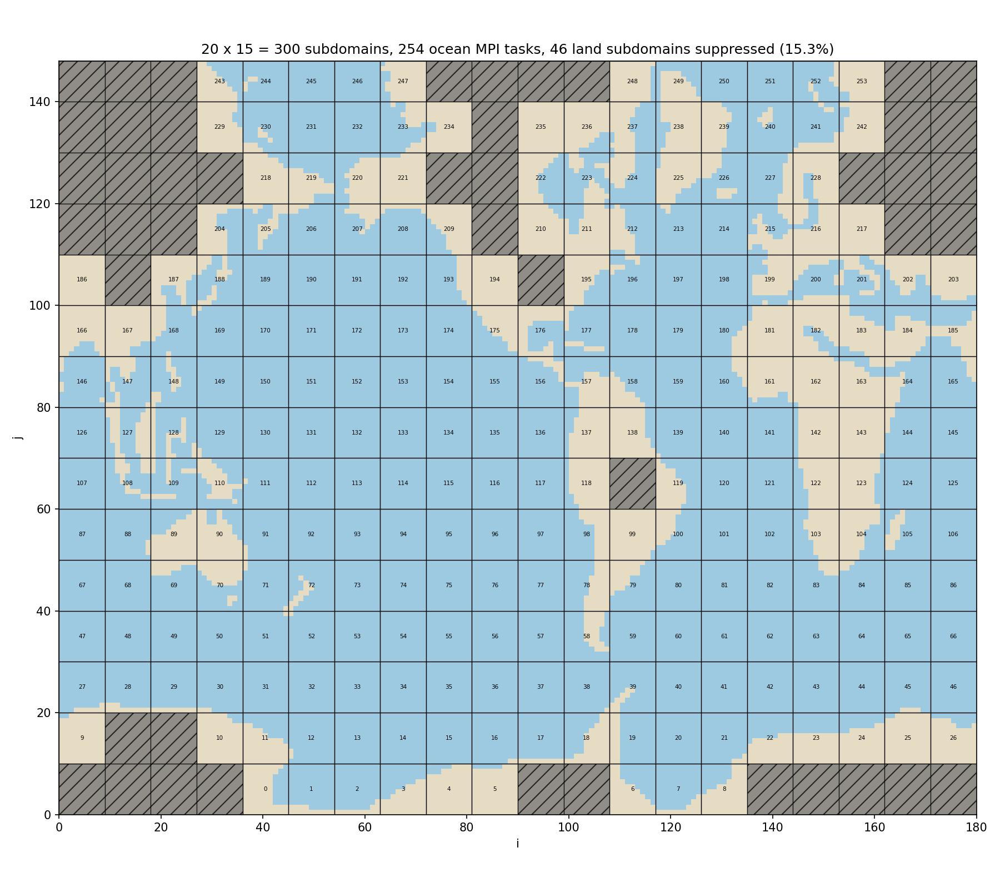

# OPALS

**Optimal Partitioning Along-with Land Suppression**

Python port of the NEMO best domain decomposition (`ln_listonly = .true.` in `&nammpp`,
see `bestpartition` / `mpp_is_ocean` / `mpp_basesplit` in NEMO `mppini.F90`):
it lists the MPI decompositions that minimise the subdomain size with land-subdomain
suppression, reading only `domain_cfg.nc` (no need to run `nemo.exe`).

Requirements: `numpy`, `xarray` (with a netCDF backend), `matplotlib` (only for `--plot`).



*Best decomposition of ORCA2 for 256 cores (`python opals.py data/orca2_mask.npz -n 256 --best --plot orca2_map.png`):
20 x 15 subdomains, 46 land-only subdomains suppressed (hatched), 254 MPI tasks labelled with their rank.*

## Usage

```
python opals.py domain_cfg.nc -n 256                          # list of best partitions, as in ocean.output
python opals.py domain_cfg.nc -n 256 -v                       # also print jpni x jpnj for each entry
python opals.py domain_cfg.nc -n 1024 --cores-per-node 128    # also the best partition for each number of nodes
python opals.py domain_cfg.nc -n 1024 --cores-per-node 128 --extra-cores 40   # 40 cores per run kept for XIOS, OIFS, ...
python opals.py domain_cfg.nc -n 256 --balance                # load-balance diagnostics for each partition
python opals.py domain_cfg.nc -n 256 --best                   # best decomposition for 256 cores + &nammpp block
python opals.py domain_cfg.nc --jpni 16 --jpnj 16 -n 256      # check a given decomposition (wasting CPU?)
python opals.py domain_cfg.nc -n 256 --best --plot map.png    # map of the subdomains, land ones shaded
python opals.py domain_cfg.nc --save-mask data/mymask.npz    # save the land-sea mask in a few kB
```

`-n` plays the role of `max(mppsize, jpni*jpnj)`: the list explores up to about
`2 * n / (1 - land fraction)` subdomains.

`--cores-per-node` picks, for each number of nodes, the partition with the smallest subdomains
that fits in it, and reports the idle cores left on the nodes (e.g. for XIOS or other components).

`--extra-cores` reserves cores on the same nodes for the other components (XIOS, OIFS, runoff-mapper, ...).

`--balance` reports, for each partition, the wet points in the inner domain of the ocean subdomains
(3D wet points when the number of levels is available, 2D otherwise):
- *wet fraction*: wet points / computed points. NEMO computes on every point of a subdomain,
  so this is the fraction of the work actually done on ocean points;
- *imbalance*: max / mean wet points per subdomain, relevant for the parts whose cost scales
  with the wet points (sea ice, I/O, some diagnostics). A minimum of 0 means that NEMO keeps
  subdomains with ocean only in their halo.

As NEMO compiled with `key_xios`, OPALS keeps the first subdomain of each row of land-only subdomains
(XIOS decomposes the domain in bands and crashes on a band without subdomains): this happens on grids whose
southern rows are all land (eORCA1, PALEORCA2). Use `--no-xios` for a NEMO executable compiled without XIOS.

A `.npz` mask written by `--save-mask` (land-sea mask + number of wet levels) can be used everywhere in place of `domain_cfg.nc`.
`domain_cfg.nc` files are too large for the repository (see `.gitignore`).

## Tests

```
python -m unittest -v test_opals
```

`data/<grid>_mask.npz` are the land-sea masks of ORCA2, PALEORCA2 (Eocene), ORCA1, eORCA1 and eORCA1_ISO,
`data/<grid>_ref.txt` the lists printed by `nemo.exe` 4.2 for the same `domain_cfg.nc` (256 cores, 947 for eORCA1),
all reproduced exactly. `data/<grid>_list.txt` are the lists computed by OPALS
(`-n 256` for ORCA2 and PALEORCA2, `-n 1024` for the 1° grids, with `-v`).
